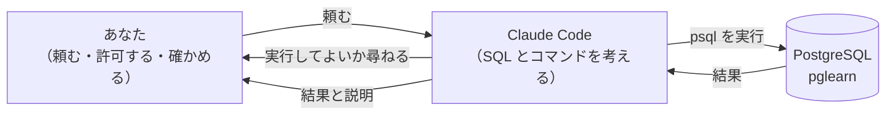

## この章で分かるようになること

- Claude Code がデータベースを操作するときに、裏で何が起きているかを説明できる
- Claude Code に `postgres` ではなく `learner` で接続させる理由を説明できる
- パスワードを Claude Code に見せずに、psql が接続できるように設定できる
- 「指示の最小型」の6項目を使って、最初の依頼を出し、結果を確かめられる

## 1. Claude Code は「psql を代わりに打つ人」

Claude Code にデータベースのことを頼むと、Claude Code は SQL を考え、psql のコマンドを組み立てて、あなたの PC で実行します。第3章・第4章であなたが打っていたコマンドを、代わりに打っているのと同じです。



この図から、約束が3つ出てきます。

| 図の場所 | 起きうること | 約束 |
|---|---|---|
| psql を実行する矢印 | 強いロールで接続すると、消してはいけないものまで消せる | **約束1** 接続は `learner` で |
| psql を実行する矢印 | パスワードを聞かれて止まる。パスワードを会話に書いてしまう | **約束2** パスワードは PC のファイルに置き、Claude Code には見せない |
| 「頼む」「尋ねる」の矢印 | 頼み方があいまいだと、意図と違う SQL が出る。許可を読まずに押すと、そのまま実行される | **約束3** 指示の最小型で頼み、**約束4** 許可する前にコマンドを読む |

> 🧭 **なぜ Claude Code を触る前に約束を決めるのか**：Claude Code は、頼まれたことを速く、それらしく実行します。間違いがあっても、エラーにならずに進むことがあります。後から気をつけるより、先に「間違えても壊れない範囲」と「確かめる場所」を決めておくほうが、確実に事故を防げます。

## 2. 約束1：接続は `learner` で

第4章で、ロールを3つ作りました。

| | `postgres` | `learner` | `reviewer` |
|---|---|---|---|
| 種類 | [[スーパーユーザー]]（何でもできる） | 学習用のふつうのロール | 検証用のふつうのロール |
| `pglearn` の表を読む | できる | できる | できる |
| `pglearn` の表を書き換える・作る・消す | できる | できる（`pglearn` の持ち主なので） | できない |
| ほかのデータベースを消す | できる | できない | できない |
| ロールを作る・消す | できる | できない | できない |
| Claude Code に使わせる | **使わせない** | SQL を書いて実行する役に使わせる | 検証する役に使わせる |

`learner` でも、`pglearn` の中の表は消せます。それでも困らないのは、第4章のリセットで、数分あれば元に戻せるからです。

> 🧭 **ロールを分ける考え方**：「何も壊せないロール」を作るのではなく、「壊れても作り直せる範囲」と「操作できる範囲」を一致させます。`pglearn` は作り直せますが、ほかのデータベースや、ロールの設定は作り直せるとは限りません。

いま接続しているロールは、次の SQL で確かめられます。

```sql
SELECT current_user, current_database();
```

:::result 1
| current_user | current_database |
|---|---|
| learner | pglearn |
:::

`current_user` が接続しているロール、`current_database` が接続しているデータベースです。2つのロールの違いは、次の SQL で見られます。

```sql
SELECT rolname, rolsuper, rolcreatedb, rolcreaterole
FROM pg_roles
WHERE rolname IN ('learner', 'postgres', 'reviewer')
ORDER BY rolname;
```

:::result 3
| rolname | rolsuper | rolcreatedb | rolcreaterole |
|---|---|---|---|
| learner | f | f | f |
| postgres | t | t | t |
| reviewer | f | f | f |
:::

psql は、正しい（true）を `t`、正しくない（false）を `f` と表示します。`rolsuper` がスーパーユーザーかどうか、`rolcreatedb` がデータベースを作れるか、`rolcreaterole` がロールを作れるかです。

`learner` と `reviewer` は、この表では同じに見えます。違いは「どの表に何をしてよいか」という、表ごとの権限にあります。`reviewer` には、`pglearn` の表を読む権限だけを与えてあります（第4章）。

> 🔍 **MCP サーバーを読み取り専用にすれば安全、ではない理由**：第2冊で、Claude Code から MCP サーバー経由でデータベースを読む方法を扱います。MCP サーバーを読み取り専用にしても、Claude Code はコマンドとして psql を直接実行できます。そのとき psql が `postgres` で接続できる状態なら、MCP の制限とは関係なく何でもできてしまいます。だから、psql が使うロールの側を `learner` に絞っておきます。

## 3. 約束2：パスワードは PC のファイルに置く

### 何もしないと、Claude Code は止まる

第4章では、psql を起動するたびにパスワードを聞かれました。Claude Code が psql を実行したときも同じことが起き、パスワードの入力待ちで止まってしまいます。Claude Code は、その入力欄に代わりに入力することができないためです。

そこで、パスワードを PC の中のファイル（[[pgpass]]）に書いておきます。psql は、このファイルに一致する行があれば、パスワードを聞かずに接続します。

### pgpass.conf を作る

1. エクスプローラーのアドレス欄に `%APPDATA%` と入力して開きます（`C:\Users\あなたの名前\AppData\Roaming` が開きます）。
2. その中に `postgresql` という名前のフォルダを作ります（すでにあれば、そのまま使います）。
3. メモ帳を開き、次の2行を書きます。最後の `パスワード` の部分は、第4章で決めた、それぞれのロールのパスワードに置き換えます。

    ```text
    localhost:5432:pglearn:learner:learnerのパスワード
    localhost:5432:pglearn:reviewer:reviewerのパスワード
    ```

4. 「名前を付けて保存」で、ファイルの種類を「すべてのファイル」にし、`pgpass.conf` という名前で、手順2のフォルダに保存します。

1行が1つのロールの分です。1行の意味は次のとおりです。コロン（`:`）で5つに区切ります。

| 位置 | 書いた値 | 意味 |
|---|---|---|
| 1 | `localhost` | 接続先のホスト |
| 2 | `5432` | ポート番号（インストールのときに変えた人は、その番号） |
| 3 | `pglearn` | データベース |
| 4 | `learner` または `reviewer` | ロール |
| 5 | パスワード | そのロールのパスワード |

`postgres` の行は書きません。書かなければ、`postgres` で接続しようとしたときは、これまでどおりパスワードを聞かれます。

> 🔍 **なぜ「すべてのファイル」を選ぶのか**：メモ帳は、ファイルの種類が「テキスト文書」のままだと、名前の後ろに `.txt` を付けて保存します。Windows は拡張子を隠す設定になっていることが多く、`pgpass.conf.txt` になっていても気づけません。psql は `pgpass.conf` という名前のファイルしか読まないので、パスワードを聞かれ続けます。

### 聞かれずに接続できるか確かめる

コマンドプロンプトで、次のコマンドを実行します。

```text
psql -h localhost -U learner -d pglearn -w -c "SELECT current_user, current_database();"
```

パスワードを聞かれずに `learner | pglearn` が表示されれば成功です。

`-w` は「パスワードを決して聞かない」という指定です。pgpass.conf が正しく読めていないと、待たずにすぐエラーで終わります。

> 🔍 **なぜ `-w` を付けるのか**：`-w` が無いと、pgpass.conf が読めていないときに、psql はパスワードの入力を待ちます。Claude Code から実行した場合、それは「何も起きないまま止まっている」ように見えます。`-w` を付けておけば、止まる代わりにエラーが出るので、原因（パスワードを渡せていない）がすぐ分かります。

### パスワードを Claude Code に見せない

pgpass.conf を作ったあとも、次のことはしないでください。

| しないこと | 理由 |
|---|---|
| Claude Code との会話にパスワードを書く | 会話の内容は、Claude Code の処理のためにインターネットの向こうへ送られ、会話の記録にも残る |
| コマンドの中にパスワードを書いてもらう（`PGPASSWORD=...` など） | 実行したコマンドは画面と記録に残る |
| pgpass.conf の中身を Claude Code に読ませる | 読ませた時点で、会話に書いたのと同じことになる |

Claude Code が「接続できないので、パスワードを教えてください」と言ってきたら、教えずに、pgpass.conf と `-w` のエラーを自分で確かめてください。

pgpass.conf にはパスワードがそのままの文字で書かれています。だから、書くのは学習用の `learner` と `reviewer` だけにしておきます。

## 4. 約束3：指示の最小型で頼む

Claude Code への頼み方は、毎回、次の6項目を入れます。この資料では、これを**指示の最小型**と呼びます。

| 番号 | 項目 | 例 |
|---|---|---|
| ① | 目的 | 配信元ごとの記事数を知りたい |
| ② | 接続先 | localhost、ロール learner、データベース pglearn |
| ③ | 使う表 | sources, articles |
| ④ | してよいこと・いけないこと | SELECT だけ。INSERT / UPDATE / DELETE はしない |
| ⑤ | 実行前に見せるもの | SQL と、どういう考えで書いたかの1行説明 |
| ⑥ | 実行後に見せるもの | 結果と、確かめるための件数（元の表の件数など） |

> 🧭 **なぜ⑤と⑥を入れるのか**：①〜④は「何をしてほしいか」、⑤と⑥は「あなたが確かめるための材料」です。Claude Code の説明の文章は、SQL の中身と食い違っていることがあります。SQL そのものと件数を見せてもらえば、説明を信じるのではなく、自分で確かめられます。

第7章の「頼み方の例」も、この6項目でできています。第3部からは、各章の「Claude Codeで使うなら」で、その章で確かめるべきこと（⑥の中身）が増えていきます。指示の型の完全版は、第2冊の第14章で扱います。

## 5. 約束4：許可する前にコマンドを読む

Claude Code は、あなたの PC でコマンドを実行する前に、「このコマンドを実行してよいか」を尋ねます。ここで読むのは、次の4か所です。

| 読む場所 | 確かめること |
|---|---|
| `-U` の後ろ | `learner` か。`postgres` なら断る |
| `-d` の後ろ | `pglearn` か |
| SQL の最初の単語 | `SELECT` か。`DELETE` `UPDATE` `DROP` `TRUNCATE` なら、頼んだ覚えがあるか。`WITH` で始まるときは、中に `DELETE` `UPDATE` `INSERT` が無いか |
| `-f` の後ろ（あれば） | 流すファイルの名前と場所が正しいか |

> 🔍 **なぜ `WITH` のときは中まで見るのか**：`WITH` で始まる SQL は、長い SQL を段に分けて書く形です（読み方は第9章）。ふつうは `SELECT` の組み合わせですが、段の中に `DELETE` などを書くこともでき、最後が `SELECT` で終わっていてもデータが変わります。最初の単語だけでは、読むか変えるかを判断できない形です。

許可の選択肢には、「今後は同じ種類のコマンドを確認しない」という意味のものが出ることがあります。psql について、これは選ばないでください。

> 🔍 **なぜ psql の「今後は確認しない」を選ばないのか**：psql は、`SELECT` も `DELETE` も同じ `psql` というコマンドで実行します。一度「確認しない」にすると、あとで `DELETE` を含むコマンドが出てきたときにも、尋ねられずに実行されます。読む機会そのものがなくなります。

## 6. 手を動かす

1. 第3節の手順で pgpass.conf を作り、`-w` 付きのコマンドで、パスワードを聞かれずに接続できることを確かめます。
2. psql で第2節の2つの SQL を実行し、`learner` で接続していること、`learner` がスーパーユーザーでないこと（`rolsuper` が `f`）を確かめます。
3. Claude Code を起動し、次のとおりに頼みます。

    ```text
    PostgreSQL 18 の学習用DBで、記事の件数を数えてください。
    ① 目的: articles の行数を知りたい
    ② 接続先: ホスト localhost、ロール learner、データベース pglearn。psql には -w を付ける
    ③ 使う表: articles
    ④ SELECT だけ実行する。INSERT / UPDATE / DELETE はしない
    ⑤ 実行前に SQL を見せる
    ⑥ 実行後に、結果の数字をそのまま表示する
    ```

4. 許可を求められたら、第5節の4か所を読んでから許可します。
5. 結果が 5 であることを確かめます。5 でなければ、第4章の軽いリセットをしてから、もう一度頼みます。

## 💡 Claude Codeで使うなら

:::claude 頼み方の例
この章で決めた約束を入れた、ふだんの頼み方の形です。「…」の部分を、その時々の内容に置き換えます。

```text
PostgreSQL 18 の学習用DBで、…してください。
① 目的: …
② 接続先: ホスト localhost、ロール learner、データベース pglearn。psql には -w を付ける
③ 使う表: …
④ SELECT だけ実行する。INSERT / UPDATE / DELETE / DROP / TRUNCATE はしない
⑤ 実行前に SQL と、どういう考えで書いたかを1行で見せる
⑥ 実行後に、結果と、元の表の件数を表示する
- パスワードは聞かない。接続できないときは、エラーの文章をそのまま見せて止まる
```

**出てきたものの検証ポイント**

1. 実行するコマンドの `-U` が `learner`、`-d` が `pglearn` か
2. 実行した SQL が、⑤で見せられた SQL と同じか
3. 報告の数字が、実行結果の表示と同じか（報告の文章だけを信じない）

**起きがちな失敗と、その理由**

- **何も表示されないまま止まる**：psql がパスワードの入力を待っています。pgpass.conf が無いか、名前が `pgpass.conf.txt` になっているか、書いた内容（データベース名・ロール名・ポート）がコマンドと一致していないことが原因です。`-w` を付けると、止まらずにエラーになります。
- **「接続できないので `postgres` で接続しました」と報告される**：Claude Code は、目的を果たすために別の方法を試すことがあります。②の接続先を毎回書き、許可の前に `-U` を読むことで防ぎます。
- **パスワードを聞かれる**：「接続のためにパスワードを教えてください」と言われても、会話には書きません。理由は第3節のとおりです。
:::

## 確認問題

:::quiz Q1. Claude Code が、次のコマンドを実行してよいか尋ねてきました。`psql -h localhost -U postgres -d pglearn -c "SELECT COUNT(*) FROM articles;"` どこを疑いますか？
`-U postgres` を疑います。SELECT だけなので結果は同じですが、スーパーユーザーで接続する習慣がつくと、いずれ DELETE や DROP も `postgres` で実行されます。許可せずに、`learner` で接続するように頼み直します。
:::

:::quiz Q2. Claude Code に件数を数えるよう頼んだら、コマンドを実行したまま数分たっても何も表示されません。何を疑いますか？
psql がパスワードの入力を待っていることを疑います。止めてから、pgpass.conf の場所と名前（`.txt` が付いていないか）、中身（`localhost:5432:pglearn:learner:…`）を確かめます。コマンドに `-w` を付けるように頼めば、次からは止まらずにエラーになります。
:::

:::quiz Q3. Claude Code が「articles は 5 件でした」と報告しました。実行したコマンドは `psql ... -c "SELECT COUNT(*) FROM articles WHERE status = 'active';"` でした。どこを疑いますか？
頼んでいない条件（`WHERE status = 'active'`）が付いていることを疑います。いまのデータではたまたま全件が `active` なので 5 になりますが、意味は「表示中の記事の件数」で、「記事の件数」とは違います。報告の文章ではなく、実行した SQL を読んで確かめます。
:::

:::why 📚 なぜ？豆知識（読み飛ばしてもかまいません）

### 🔍 スーパーユーザーは、データベースの外にも手が届く

スーパーユーザーは、データベースの中だけでなく、PostgreSQL が動いている PC のファイルを読み書きしたり、PC のコマンドを実行したりする SQL も使えます（例：`COPY ... TO PROGRAM`）。`postgres` で接続した Claude Code は、psql 経由で PC そのものにも手が届く、ということです。`learner` にはこの力がありません。

### 🧭 決まりごとを毎回書かずに済ませる方法

②の接続先や④の禁止事項は、毎回同じです。Claude Code には、作業するフォルダに置いた `CLAUDE.md` というファイルを、毎回読み込む仕組みがあります。たとえば `C:\pglearn\CLAUDE.md` に次のように書いておき、そのフォルダで Claude Code を起動すると、毎回の依頼に書く量を減らせます。

```text
# この作業フォルダでの約束
- PostgreSQL には、ホスト localhost、ロール learner、データベース pglearn で接続する。psql には -w を付ける
- postgres ロールでは接続しない
- 頼まれていない INSERT / UPDATE / DELETE / DROP / TRUNCATE はしない
- パスワードは聞かない。接続できないときは、エラーの文章を見せて止まる
```

ただし、`CLAUDE.md` は「守ってほしいお願い」で、守らせる仕組みではありません。許可の前にコマンドを読む（約束4）のは、`CLAUDE.md` を置いても続けてください。パスワードは `CLAUDE.md` にも書きません。

### 🔍 読み取りしかできないロールは第18章で

`learner` は表を消せるロールです。「読むことしかできないロール」を作ると、Claude Code が間違えても、データは変わりません。ロールの権限を細かく決める方法（`GRANT` / `REVOKE`）は、MCP サーバーと一緒に第18章で扱います。

さらに知りたい人は、公式ドキュメント（PostgreSQL 18）の [パスワードファイル](https://www.postgresql.org/docs/18/libpq-pgpass.html) と [ロールの属性](https://www.postgresql.org/docs/18/role-attributes.html) を参照してください。
:::

:::check
Claude Code が実行するコマンドの `-U`（`learner` か）と `-d`（`pglearn` か）を、許可する前に読んだか
:::
