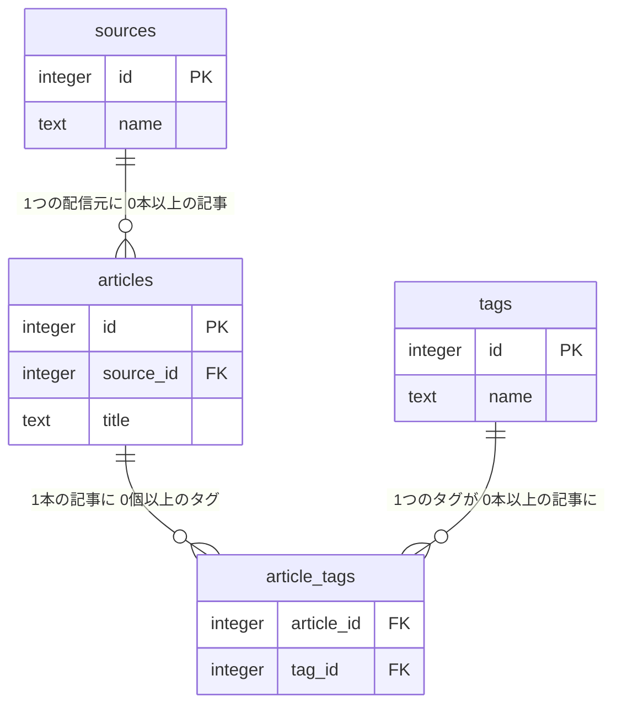

## この章で分かるようになること

- [[JOIN]]（結合）が何をしているかを、「行の動き」で説明できる
- INNER JOIN と LEFT JOIN の違いを、「どの行が消えるか」で説明できる
- Claude Code が書いた JOIN を見て、行が増えていないか、消えていないかを自分で確かめられる

## 1. JOINは「分けた表を、読むときだけ元に戻す」操作

第2章で、配信元の名前を記事ごとに書くのをやめ、`sources`（配信元）テーブルに分けました。記事の側には、名前の代わりに配信元の番号（`source_id`）だけを持たせています。



記事の一覧に配信元の名前を表示したいときは、`articles.source_id` と `sources.id` が同じ行どうしを横に並べます。これが JOIN です。

> 🧭 **なぜ分けたのに戻すのか**：保存するときは「1つの事実を1か所にだけ書く」ほうが、表記ゆれや直し漏れが起きません。読むときは人が読みやすい形が必要です。保存と表示で形を変えるために、分けて保存し、読むときに JOIN で戻します。

JOIN の SQL は、`ON` の行を最初に読みます。`ON` には「どの列とどの列が同じなら、同じ行に並べるか」が書いてあります。

```sql
SELECT a.id, a.title, s.name AS source_name
FROM articles AS a
INNER JOIN sources AS s ON s.id = a.source_id   -- ← ここを最初に読む
ORDER BY a.id;
```

`AS a` や `AS s` は、テーブルに付けた短い呼び名（別名）です。`a.title` は「articles の title 列」と読みます。

## 2. INNER JOIN：相手がいない行は消える

上の SQL を実行した結果です。

:::result 4
| id | title | source_name |
|---:|---|---|
| 1 | クラウド利用料、来春から改定へ | テック日報 |
| 2 | 社内AIの導入率が過半数に | テック日報 |
| 3 | 半導体工場の新設計画を発表 | 経済ウィークリー |
| 4 | 為替相場、週明けは小動き | 経済ウィークリー |
:::

記事は5本あるのに、結果は4行です。記事5「配信元不明の転載記事」が消えました。エラーは出ていません。

> 🔍 **なぜ消えるのか**：INNER JOIN は「両方の表に相手がいる行」だけを残します。記事5の `source_id` は [[NULL]]（不明）で、どの `sources.id` とも一致しないため、相手がいない行として捨てられます。

<div class="fig" markdown="0">
  <div class="fig-cap">図7-1　INNER JOIN で行が消える</div>
  <div class="fig-row">
    <table class="mini">
      <caption>articles（5行）</caption>
      <tr><th>id</th><th>source_id</th></tr>
      <tr><td>1</td><td>1</td></tr>
      <tr><td>2</td><td>1</td></tr>
      <tr><td>3</td><td>2</td></tr>
      <tr><td>4</td><td>2</td></tr>
      <tr class="lost"><td>5</td><td class="null">NULL</td></tr>
    </table>
    <div class="fig-arrow" aria-hidden="true">→</div>
    <table class="mini">
      <caption>INNER JOIN の結果（4行）</caption>
      <tr><th>id</th><th>source_name</th></tr>
      <tr><td>1</td><td>テック日報</td></tr>
      <tr><td>2</td><td>テック日報</td></tr>
      <tr><td>3</td><td>経済ウィークリー</td></tr>
      <tr><td>4</td><td>経済ウィークリー</td></tr>
      <tr class="gone"><td colspan="2">記事5は相手がいないので消える</td></tr>
    </table>
  </div>
</div>

## 3. LEFT JOIN：左の表は全部残す

`INNER JOIN` を `LEFT JOIN` に変えるだけで、結果が変わります。

```sql
SELECT a.id, a.title, s.name AS source_name
FROM articles AS a
LEFT JOIN sources AS s ON s.id = a.source_id
ORDER BY a.id;
```

:::result 5
| id | title | source_name |
|---:|---|---|
| 1 | クラウド利用料、来春から改定へ | テック日報 |
| 2 | 社内AIの導入率が過半数に | テック日報 |
| 3 | 半導体工場の新設計画を発表 | 経済ウィークリー |
| 4 | 為替相場、週明けは小動き | 経済ウィークリー |
| 5 | 配信元不明の転載記事 | <span class="null">NULL</span> |
:::

「左」とは、先に書いた表（`FROM` の直後の表）のことです。LEFT JOIN は、左の表の行を必ず全部残し、相手がいなければ右側の列を [[NULL]] で埋めます。

どちらを使うかは、「何を全部見たいか」で決まります。

| 知りたいこと | 左に置く表 | JOIN |
|---|---|---|
| 配信元が分かっている記事だけ | articles | INNER JOIN |
| 全記事。配信元が分かれば名前も | articles | LEFT JOIN |
| 全配信元と記事数（0本の配信元も含む） | sources | LEFT JOIN |

3行目を実行すると、記事が1本もない「地域ニュース栃木」も 0 として出ます。

```sql
SELECT s.name, COUNT(a.id) AS article_count
FROM sources AS s
LEFT JOIN articles AS a ON a.source_id = s.id
GROUP BY s.id, s.name
ORDER BY s.id;
```

:::result 3
| name | article_count |
|---|---:|
| テック日報 | 2 |
| 経済ウィークリー | 2 |
| 地域ニュース栃木 | 0 |
:::

> 🔍 **なぜ `COUNT(a.id)` なのか**：`COUNT(*)` は「行の数」を数えます。地域ニュース栃木の行は、記事側が NULL で埋まった1行として存在するので、`COUNT(*)` だと 1 になります。`COUNT(a.id)` は NULL を数えないので 0 になります。

## 4. 行が増える：1対多のJOIN（この章でいちばん大事）

記事にタグを並べてみます。記事とタグは「1本の記事に複数のタグ」がある関係（1対多）です。

```sql
SELECT a.id, a.title, t.name AS tag
FROM articles AS a
JOIN article_tags AS at ON at.article_id = a.id
JOIN tags AS t ON t.id = at.tag_id
ORDER BY a.id, t.id;
```

:::result 8
| id | title | tag |
|---:|---|---|
| 1 | クラウド利用料、来春から改定へ | クラウド |
| 1 | クラウド利用料、来春から改定へ | 経済 |
| 2 | 社内AIの導入率が過半数に | AI |
| 2 | 社内AIの導入率が過半数に | 経済 |
| 3 | 半導体工場の新設計画を発表 | AI |
| 3 | 半導体工場の新設計画を発表 | 半導体 |
| 3 | 半導体工場の新設計画を発表 | 経済 |
| 4 | 為替相場、週明けは小動き | 経済 |
:::

記事は5本なのに8行になりました。記事3は3回出てきます。（`JOIN` とだけ書くと `INNER JOIN` と同じ意味なので、タグのない記事5は消えています。）

<div class="fig" markdown="0">
  <div class="fig-cap">図7-2　1対多の JOIN で行が増える（記事3の場合）</div>
  <div class="fig-row">
    <table class="mini">
      <caption>articles（記事3は1行）</caption>
      <tr><th>id</th><th>title</th></tr>
      <tr class="hit"><td>3</td><td>半導体工場の…</td></tr>
    </table>
    <div class="fig-arrow" aria-hidden="true">×</div>
    <table class="mini">
      <caption>article_tags（記事3に3行）</caption>
      <tr><th>article_id</th><th>tag_id</th></tr>
      <tr class="hit"><td>3</td><td>1</td></tr>
      <tr class="hit"><td>3</td><td>3</td></tr>
      <tr class="hit"><td>3</td><td>4</td></tr>
    </table>
    <div class="fig-arrow" aria-hidden="true">→</div>
    <table class="mini">
      <caption>結果（記事3が3行）</caption>
      <tr><th>id</th><th>tag_id</th></tr>
      <tr class="dup"><td>3</td><td>1</td></tr>
      <tr class="dup"><td>3</td><td>3</td></tr>
      <tr class="dup"><td>3</td><td>4</td></tr>
    </table>
  </div>
</div>

> 🔍 **なぜ増えるのか**：JOIN は「条件に一致する組み合わせ」を全部作ります。記事3の1行に対して、一致するタグの行が3つあれば、組み合わせは3つです。

一覧表示ならこれで正しいのですが、**数える**ときに事故が起きます。「配信元ごとの記事数」を、タグまで結合したまま数えた例です。

```sql
SELECT s.name, COUNT(*) AS article_count
FROM articles AS a
JOIN sources AS s ON s.id = a.source_id
JOIN article_tags AS at ON at.article_id = a.id   -- ← 記事数には不要な結合
GROUP BY s.id, s.name
ORDER BY s.id;
```

:::result 2 wrong
| name | article_count |
|---|---:|
| テック日報 | 4 |
| 経済ウィークリー | 4 |
:::

正しくはどちらも 2 です。エラーにはならず、それらしい数字が返ってきます。これが「エラーにならずに結果がズレる」典型です。

直し方は2つあります。

| 直し方 | SQL の変更 | 評価 |
|---|---|---|
| A. 不要な表を結合しない | `article_tags` の JOIN を消す | **推奨**。増える原因そのものがなくなる |
| B. 重複を除いて数える | `COUNT(DISTINCT a.id)` にする | 件数は合う。ただし原因は残り、`SUM`（合計）などでは同じ方法で直せない |

第6章の「ズレの3分類」に当てはめると、この章で見たものは次のとおりです。

| 分類 | この章の例 | 気づき方 |
|---|---|---|
| 行が減る | INNER JOIN で、配信元不明の記事が消えた | JOIN 前の件数と比べる |
| 行が増える | タグを結合して、記事数が2倍になった | 結果の合計が、元の件数を超えていないか見る |
| 値が変わる | LEFT JOIN と `COUNT(*)` で、0 が 1 になった | 0件のはずの行を1つ確かめる |

## 5. 手を動かす

psql（または pgAdmin4 の Query Tool）で、第4章で作った学習用データベースに接続して実行します。

1. 先に、基準になる件数を数えます。

    ```sql
    SELECT COUNT(*) FROM articles;      -- 5 になるはず
    SELECT COUNT(*) FROM article_tags;  -- 8 になるはず
    ```

2. 第2節（INNER JOIN）と第3節（LEFT JOIN）の SQL を実行し、行数が 4 と 5 になることを確かめます。
3. 第4節の「記事数が 4 になる SQL」を実行し、正しい答え（2）と違うことを確かめます。
4. 直し方 A と B を自分で書き換え、どちらも 2 になることを確かめます。

検算は、いつも次の4つの順番で行います。

| 手順 | やること | この章の例 |
|---|---|---|
| ① | 基準の表の件数を数える | articles は 5 |
| ② | JOIN 後の件数を数える | INNER JOIN で 4 |
| ③ | 差の理由を言葉で説明する | 配信元が NULL の記事が1本消えた |
| ④ | 期待していた件数と比べる | 「配信元が分かる記事だけ」なら 4 で正しい |

③で理由を説明できないときは、その結果を使わずに、資料作成者に質問してください（質問テンプレートは第0章）。

## 💡 Claude Codeで使うなら

:::claude 頼み方の例
```text
PostgreSQL 18 の学習用DB（pglearn）で、配信元ごとの記事数を出す SELECT を書いてください。
- 対象テーブル: sources, articles
- 記事が0本の配信元も 0 として表示する
- 配信元が不明（source_id が NULL）の記事は数えない
- 実行前に SQL を見せ、JOIN の種類（INNER / LEFT）と、どの表を左にしたかを1行で説明する
- 実行後、articles の総件数と、結果の合計を並べて表示する
- INSERT / UPDATE / DELETE は実行しない
```

**出てきたものの検証ポイント**

1. JOIN の種類と「左の表」が、頼んだ内容（全配信元を出す → sources が左の LEFT JOIN）と一致しているか
2. 頼んでいない1対多の表（`article_tags` など）が結合されていないか
3. `COUNT(*)` か `COUNT(列)` か
4. 結果の合計（2＋2＋0＝4）と総件数（5）の差を説明できるか。差の1は配信元不明の記事です

**起きがちな失敗と、その理由**

- **関係しそうな表まで結合して、件数が増える**：「念のため」に関連する表を広く結合した SQL が出てくることがあります。頼み方に「使う表」を書いておくと防げます。
- **LEFT JOIN にしたのに、相手のいない行が消える**：右の表の列を `WHERE` で絞ると、結果が INNER JOIN と同じになります（理由は下の豆知識）。
- **`DISTINCT` を付けて「直しました」と報告される**：件数は合いますが、余計な結合は残っています。どの表を結合したかを、必ず SQL で確かめてください。
:::

## 確認問題

:::quiz Q1. Claude Code が「配信元ごとの記事数」として「テック日報 4、経済ウィークリー 4」を返しました。articles の総件数は 5 です。どこを疑いますか？
結果の合計は 8 で、記事の総数 5 を超えています。1対多の表を結合して行が増えていると考え、SQL の中に `article_tags` などの結合が入っていないかを確かめます。
:::

:::quiz Q2. LEFT JOIN で配信元ごとの記事数を出したら、記事が1本もない「地域ニュース栃木」が 1 になりました。どこを疑いますか？
`COUNT(*)` で数えていないかを疑います。LEFT JOIN では、相手がいない配信元も NULL で埋まった1行として残るので、`COUNT(*)` は 1 を返します。`COUNT(a.id)` にすると 0 になります。
:::

:::quiz Q3. 「全配信元を表示し、10月2日以降の記事があれば並べて」と頼んだら、地域ニュース栃木が結果に出てきませんでした。SQL は LEFT JOIN でした。どこを疑いますか？
記事の公開日時の条件が `WHERE` に書かれていないかを疑います。右の表の列を `WHERE` で絞ると、相手がいない行（NULL の行）が落ちます。条件を `ON` に移すと、地域ニュース栃木が残ります。
:::

:::why 📚 なぜ？豆知識（読み飛ばしてもかまいません）

### 🔍 LEFT JOIN に WHERE を付けると、なぜ INNER JOIN と同じになるのか

SQL は、考え方の順番として「`FROM` と `JOIN` で表を作る → `WHERE` で行を絞る」と進みます。

```sql
SELECT s.name, a.title
FROM sources AS s
LEFT JOIN articles AS a ON a.source_id = s.id
WHERE a.published_at >= '2026-10-02 00:00+09'   -- ← ここで NULL の行が落ちる
ORDER BY s.id, a.id;
```

LEFT JOIN の時点では、地域ニュース栃木の行は記事側が NULL のまま残っています。ところが `WHERE` では、`NULL >= 日時` は「真」でも「偽」でもなく「不明」になります。`WHERE` は「真」の行だけを残すので、この行は落ちます（第9章の NULL の三値論理）。結果は2行です。

条件を `ON` に書くと、意味が「どの記事を相手にするか」に変わり、左の表の行は残ります。

```sql
SELECT s.name, a.title
FROM sources AS s
LEFT JOIN articles AS a ON a.source_id = s.id
                       AND a.published_at >= '2026-10-02 00:00+09'
ORDER BY s.id, a.id;
```

:::result 3
| name | title |
|---|---|
| テック日報 | 社内AIの導入率が過半数に |
| 経済ウィークリー | 半導体工場の新設計画を発表 |
| 地域ニュース栃木 | <span class="null">NULL</span> |
:::

日時を `'2026-10-02 00:00+09'` のようにタイムゾーン付きで書いているのは、接続先の設定によって「10月2日0時」の意味が変わらないようにするためです（第2章）。

### 🧭 RIGHT JOIN をあまり使わない理由

`A RIGHT JOIN B` は、`B LEFT JOIN A` と同じ結果になります。左を基準に読む習慣にそろえたほうが読み間違いが減るので、多くの現場では LEFT JOIN だけを使います。Claude Code への頼み方に「RIGHT JOIN は使わず、LEFT JOIN で書くこと」と入れてもかまいません。

### 🔍 「全部の組み合わせを作ってから絞る」という考え方

JOIN は、「左の表と右の表の、すべての組み合わせを作り、`ON` の条件に合うものだけを残す」と考えると、行が増える理由も減る理由も説明できます。すべての組み合わせを作る操作には `CROSS JOIN`（直積）という名前があります。

実際の PostgreSQL は、本当にすべての組み合わせを作るような無駄はせず、データの量に応じて効率のよい方法を選びます。どの方法を選んだかを見る方法は、別冊1（インデックスと EXPLAIN）で扱います。

この資料で扱うのはここまでです。さらに知りたい人は、公式ドキュメント（PostgreSQL 18）の [テーブル間の結合（チュートリアル）](https://www.postgresql.org/docs/18/tutorial-join.html) と [テーブル式](https://www.postgresql.org/docs/18/queries-table-expressions.html) を参照してください。
:::

:::check
JOIN の前後で行数を比べ、増えた理由（1対多）または減った理由（INNER JOIN で相手がいない）を説明できるか
:::
