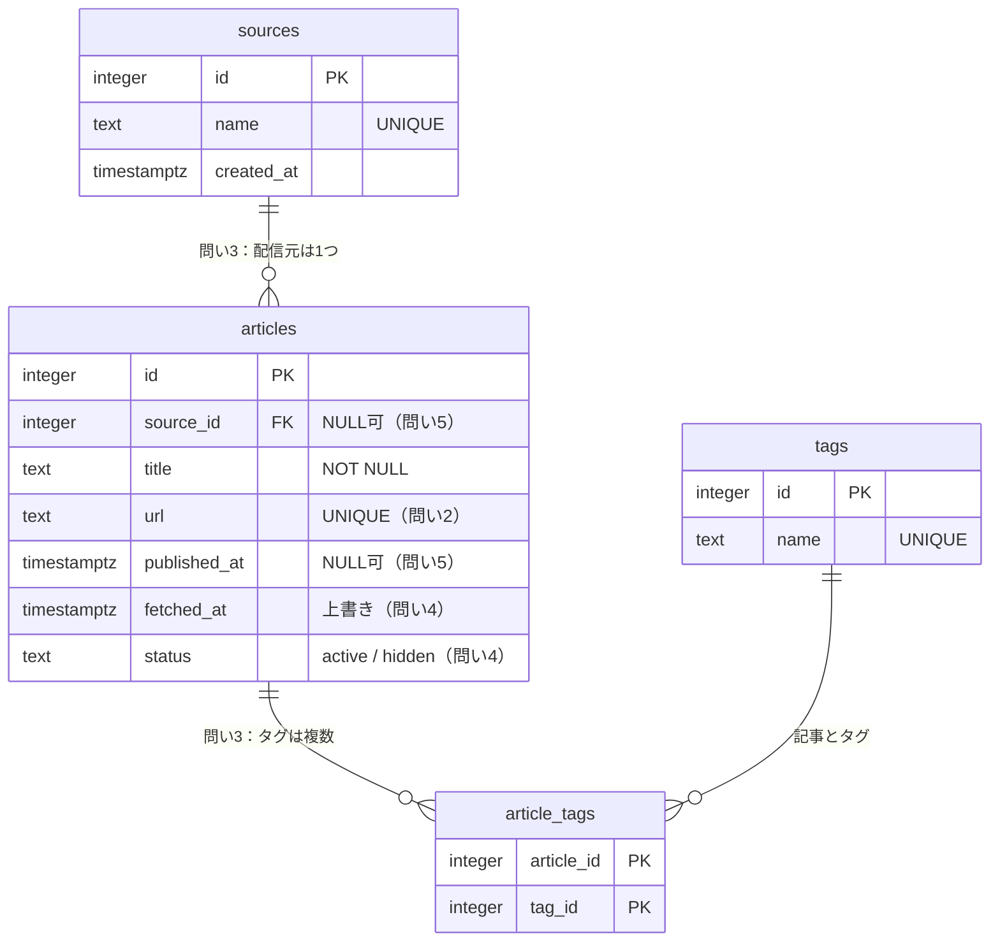

## この章で分かるようになること

- 初めて見る外部データから、テーブルの分け方、[[主キー]]、NULL を許すかどうかを、自分で決める手順が分かる
- 第3章で入れたサンプルのテーブルが、なぜあの形なのかを説明できる
- Claude Code が出した設計案を、5つの問いで評価できる

## 1. 覚えるのは「答え」ではなく「問い」

正しい設計は、データの中身と、そのデータで何をしたいかによって変わります。ニュースとファイル情報では答えが違いますし、同じニュースでも「記事を一覧したい」のか「取得の履歴を追いたい」のかで変わります。

そこでこの資料では、設計の答えを覚えるのではなく、どんなデータにも使える **5つの問い** を覚えます。問いに順番に答えると、設計が決まります。

| # | 問い | 決まるもの |
|---|---|---|
| 1 | 1行は何を表すか | テーブルの[[粒度]]（何を1件と数えるか） |
| 2 | 何で「同じもの」と判定するか | [[主キー]]、[[UNIQUE制約]] |
| 3 | 1つのものに、複数あるものはあるか | 表を分けるか、[[中間テーブル]]を作るか |
| 4 | あとで変わるか。変わったら履歴は要るか | 上書きするか、履歴を残すか、削除の扱い |
| 5 | 欠けることはあるか。何で検索したいか | NULL を許すか、[[インデックス]]を付けるか |

> 🧭 **なぜこの順番なのか**：問い1が決まらないと、問い2の「同じもの」が何の話か決まりません。後ろの問いほど、前の答えに頼っています。

## 2. 材料：取得したニュースの生データ

ニュースサイトから記事の情報を取得したら、次の6行が届いたとします（記事も配信元も架空です）。

| # | 取得日時 | タイトル | URL | 配信元 | 公開日時 | タグ |
|---:|---|---|---|---|---|---|
| 1 | 10/01 10:00 | クラウド利用料、来春から改定へ | `…/tech/1001` | テック日報 | 10/01 09:00 | クラウド, 経済 |
| 2 | 10/02 10:00 | 社内AIの導入率が過半数に | `…/tech/1002?utm_source=rss` | テック日報 | 10/02 08:30 | AI, 経済 |
| 3 | 10/02 13:00 | 半導体工場の新設計画を発表 | `…/econ/2001` | 経済ウ<mark>イ</mark>ークリー | 10/02 12:00 | AI, 半導体, 経済 |
| 4 | 10/02 15:00 | 社内AIの導入率が過半数に | `…/tech/1002` | テック日報 | 10/02 08:30 | AI, 経済 |
| 5 | 10/03 13:00 | 為替相場、週明けは小動き | `…/econ/2002` | 経済ウィークリー | （空欄） | 経済 |
| 6 | 10/03 19:00 | 配信元不明の転載記事 | `…/misc/9001` | （空欄） | 10/03 18:00 | （なし） |

URL の先頭 `https://example.com` は省略しています。この表を見ながら、5つの問いに答えていきます。

## 3. 5つの問いに答える

### 問い1　1行は何を表すか

生データの1行は「1回の取得」です。2行目と4行目は、同じ記事を2回取得したものです。つまり **取得は6回、記事は5本** です。

ここで「記事の一覧を作りたい」のであれば、テーブルの1行は **1本の記事** にします。

| 選んだ答え | 代償と最悪ケース |
|---|---|
| 1行＝1本の記事 | 「いつ何回取得したか」は残らない。必要なら取得履歴の表を別に作る（問い4） |
| 1行＝1回の取得 | 記事数を数えるたびに重複を除く必要がある。忘れると記事数が6になる |

> 🔍 **なぜ最初に決めるのか**：1行が何かを決めないまま作ると、「記事」と「取得」が混ざった表になります。数えた結果が記事数なのか取得回数なのか、誰にも分からなくなります。

### 問い2　何で「同じもの」と判定するか

2行目と4行目を同じ記事だと判定するには、どの項目を見ればよいでしょうか。

| 候補 | このデータでの結果 | 判断 |
|---|---|---|
| タイトル | 2行目と4行目は一致する | 別の記事が同じタイトルになることがあり、安全ではない |
| URL（そのまま） | `?utm_source=rss` の有無で **別物になる** | このままでは重複が入る |
| URL（[[正規化]]したもの） | 計測用の `?utm_…` を取り除けば一致する | **採用**。正規化のルールを決めて文書に残す |

決まったこと：`url` 列に [[UNIQUE制約]] を付け、保存する前に正規化します。行を区別する番号として、別に `id`（[[主キー]]）も持たせます。

> 🧭 **なぜ URL があるのに id を別に作るのか**：URL は長く、サイトの引っ越しで変わることもあります。他の表から参照するときは、変わらない短い番号のほうが扱いやすいからです。

### 問い3　1つのものに、複数あるものはあるか

| 項目 | 1本の記事に対して | 決まったこと |
|---|---|---|
| 配信元 | 1つ | 記事の表に `source_id` を持たせる。名前は `sources` に分ける |
| タグ | 0個以上（記事3は3つ） | `article_tags`（[[中間テーブル]]）を作る |

配信元を分けるのは、3行目の「経済ウ**イ**ークリー」のような表記ゆれを1か所で直せるようにするためです。タグを中間テーブルにすると、第7章で見たとおり、JOIN で行が増えることにも注意が必要になります。

### 問い4　あとで変わるか。変わったら履歴は要るか

| 変わりうるもの | 決まったこと |
|---|---|
| 記事が取り下げられる | 行は削除せず、`status` を `hidden` にする |
| タイトルが訂正される | 今回は上書きする（訂正前のタイトルは要らないと決めた） |
| 同じ記事を何度も取得する | `fetched_at`（最後に取得した日時）を上書きする。取得履歴が必要になったら表を足す |

### 問い5　欠けることはあるか。何で検索したいか

| 項目 | 欠けるか | 決まったこと |
|---|---|---|
| 公開日時 | 5行目は空欄 | `published_at` は NULL を許す。取得日時で埋めない（事実と違う値になるため） |
| 配信元 | 6行目は空欄 | `source_id` は NULL を許す。第7章の INNER JOIN で消えた記事がこれ |
| タイトル、URL | 必ずある | `NOT NULL` にする |

検索に使いそうなのは、公開日時の範囲、配信元、タグです。これはインデックスの候補として控えておきます（詳しくは別冊1）。

## 4. 答えを並べると、第3章のテーブルになる

5つの問いの答えをまとめると、第3章で入れたサンプルのテーブルになります。



## 5. 手を動かす

1. psql で次のコマンドを実行し、articles テーブルの定義を表示します。

    ```text
    \d articles
    ```

    表示される主な行と、どの問いの答えかの対応は次のとおりです。（日本語の環境では、見出しが日本語で表示されることがあります。）

    | 表示 | 意味 | 問い |
    |---|---|---|
    | `"articles_pkey" PRIMARY KEY, btree (id)` | id が主キー | 問い2 |
    | `"articles_url_key" UNIQUE CONSTRAINT, btree (url)` | 同じ URL は入らない | 問い2 |
    | `published_at` の Nullable 欄が空 | NULL を許す | 問い5 |
    | `FOREIGN KEY (source_id) REFERENCES sources(id)` | 存在しない配信元は入らない | 問い3 |
    | `CHECK (status = ANY (ARRAY['active'::text, 'hidden'::text]))` | status は2種類だけ | 問い4 |

2. 次はファイル情報の生データです。問い1と問い2に、自分で答えてから答え合わせをしてください。

    | # | パス | サイズ | 更新日 | 中身のハッシュ（先頭8文字） |
    |---:|---|---:|---|---|
    | 1 | `C:\Share\企画\提案書_v1.docx` | 48 KB | 10/01 | `3f2a9c1e` |
    | 2 | `C:\Share\企画\提案書_v1.docx` | 52 KB | 10/05 | `8b7d0e44` |
    | 3 | `C:\Share\共有\提案書_コピー.docx` | 48 KB | 10/01 | `3f2a9c1e` |

    [[ハッシュ]]は、ファイルの中身から計算した指紋のような値で、中身が同じなら同じ値になります。

:::quiz 答え合わせ（問い1と問い2）
**問い1**：1行は「あるパスにあるファイルの、ある時点の状態」です。1行目と2行目は、同じファイルを別の日に調べた結果です。「ファイルの一覧」が欲しいのか、「変化の履歴」が欲しいのかで、表の粒度が変わります。

**問い2**：パスで判定すると、1行目と3行目は別のファイルです。ハッシュで判定すると、同じ中身なので同じものです。「どこに何があるか」を知りたいならパス、「同じ中身の重複を見つけたい」ならハッシュが合います。両方を知りたい場合は、表を分ける設計になります（別冊3で扱います）。

Windows のパスは、大文字と小文字を区別しません（`C:\share` と `C:\Share` は同じ場所）。一方、PostgreSQL の UNIQUE 制約は区別するので、パスで判定する場合は、保存する前に表記をそろえる必要があります。
:::

## 💡 Claude Codeで使うなら

:::claude 頼み方の例
第4章の作業フォルダ（`C:\pglearn\`）で頼むときの形です。接続先・してはいけないこと・検証材料 a・b・d・e・検証役（`sql-checker`）は `CLAUDE.md` に書いてあるので、依頼に書くのは①目的と③使う表、それにこの章で足すことだけです。

```text
PostgreSQL 18 で、次のニュースデータを保存するテーブル設計案を出してください。
① 目的: ニュースを保存し、公開日時・配信元・タグで検索できるようにしたい
③ 使う表: なし（新しく設計する）。生データは次のとおり
（ここに生データを数行貼る）

e（前提）として、設計案を出す前に、次の5つの問いに対するあなたの仮定を、表で示してください。
1. 1行は何を表すか
2. 何で「同じもの」と判定するか
3. 1つのものに複数あるものは何か
4. あとで変わるもの、履歴が必要なもの
5. 欠ける項目と、検索に使う項目

- 自信がない問いには「要確認」と書く
- CREATE TABLE は案として表示するだけで、実行しない
```

設計案は実行しないので、検証役は呼ばれません。その代わりに、e（前提）を5つの問いの形で出させて、あなたが1問ずつ確かめます。

**出てきたものの検証ポイント**

1. 仮定の表を、自分の答えと1問ずつ比べる。違うところは、どちらが目的に合うかを決めてから設計に進む
2. `CREATE TABLE` の中で、主キーと UNIQUE が問い2、NOT NULL の有無が問い5、中間テーブルが問い3と一致しているか
3. 「要確認」が付いた問いを放置していないか

**起きがちな失敗と、その理由**

- **タグを1つの列に「AI,経済」とまとめて入れる案が出る**：問い3を飛ばしています。タグで絞り込んだり数えたりするときに、文字列を分解する必要が出て、間違いの元になります。
- **URL をそのまま UNIQUE にする**：計測用の付加情報が付いた URL が別物として入り、重複が残ります。
- **公開日時を NOT NULL にする**：欠けたデータの取り込みが失敗するか、空欄を取得日時で埋めて事実と違うデータになります。
- **そもそも仮定を示さずに、いきなり CREATE TABLE を出す**：Claude Code はデータから仮定を推測して設計を完成させるので、仮定を明示させないと、どこで判断したのかが見えません。頼み方の「仮定を表で示して」はそのためです。
:::

## 確認問題

:::quiz Q1. Claude Code の設計案が articles(id, url, title, source_name text, tags text) でした。どこを疑いますか？
`source_name` を記事の表に直接書いている点と、`tags` を1つの文字列の列にしている点を疑います。どちらも問い3（1つに複数あるか、表記をそろえられるか）の答えが反映されていません。
:::

:::quiz Q2. 生データ6行を取り込んだら、articles の件数が 6 になりました。記事は5本のはずです。どこを疑いますか？
問い2を疑います。URL を正規化せずに UNIQUE にしたため、`?utm_source=rss` 付きの URL が別の記事として入った可能性があります。または、問い1で1行を「1回の取得」にしてしまっていないかを確かめます。
:::

:::quiz Q3. 設計案で published_at が NOT NULL になっていて、「空欄のときは取得日時を入れる」と説明されました。どこを疑いますか？
問い5を疑います。公開日時は欠けることがあるデータなので、NULL を許すのが自然です。取得日時で埋めると、「公開日時」の列に事実と違う値が入り、公開日での並べ替えや絞り込みが間違います。
:::

:::why 📚 なぜ？豆知識（読み飛ばしてもかまいません）

### 📜 「正規化」はどこから来たのか

表を分けて「1つの事実を1か所に」書く考え方は、IBM の研究者だったエドガー・F・コッド（Edgar F. Codd）が1970年に発表した関係モデル（relational model）と、その後の論文で整理されました。「リレーショナル（relational）」は、数学の「関係（relation）」という言葉から来ていて、表そのものを指します。テーブル同士のつながりのことではありません。

### 🧭 「粒度」を最初に決めるのは、分析の世界でも同じ

データ分析用のテーブル設計でも、最初の手順は「1行が何を表すか」（grain：粒度）を決めることだとされています。粒度が混ざると、どの集計も信用できなくなるからです。

### 🔍 URL の正規化でよく使うルール

よく使われるのは、次のようなルールです。どれを採用するかは目的によって決め、決めたルールはデータ辞書（付録F）に書いておきます。

- スキーム（`https`）とホスト名を小文字にそろえる
- `?utm_source=…` のような計測用の付加情報を取り除く
- `#` 以降（ページ内の位置）を取り除く
- 末尾の `/` の有無をそろえる

この資料で扱うのはここまでです。制約の詳しい書き方は、公式ドキュメント（PostgreSQL 18）の [制約](https://www.postgresql.org/docs/18/ddl-constraints.html) を参照してください。
:::

:::check
設計案を受け取る前に、5つの問いへの仮定を表で出させ、自分の答えと比べたか
:::
